# Student-Database-Management-System

Features : 

Staff Registration & Login
Add Student
View, Update, Delete Student Information
Add Marks
View, Update, Delete Marks
Add Attendance
View, Update, Delete Attendance
Home Page
Contact Us
About Us
Staff Logout

Technology Stack : 

Spring Boot: Backend framework for handling business logic and data persistence.

Thymeleaf: Templating engine for dynamic server-side HTML rendering.

Spring Data JPA & Hibernate: Database interaction and object-relational mapping.

MySQL: Relational database for storing student data.

HTML, CSS, JavaScript: Frontend structure, styling, and interactivity.

Spring Security: Authentication and authorization for secure access.

Maven: Dependency management and build automation.

---

## Screenshots

  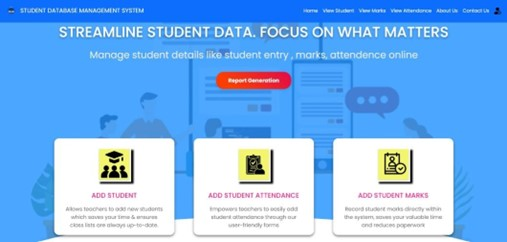
  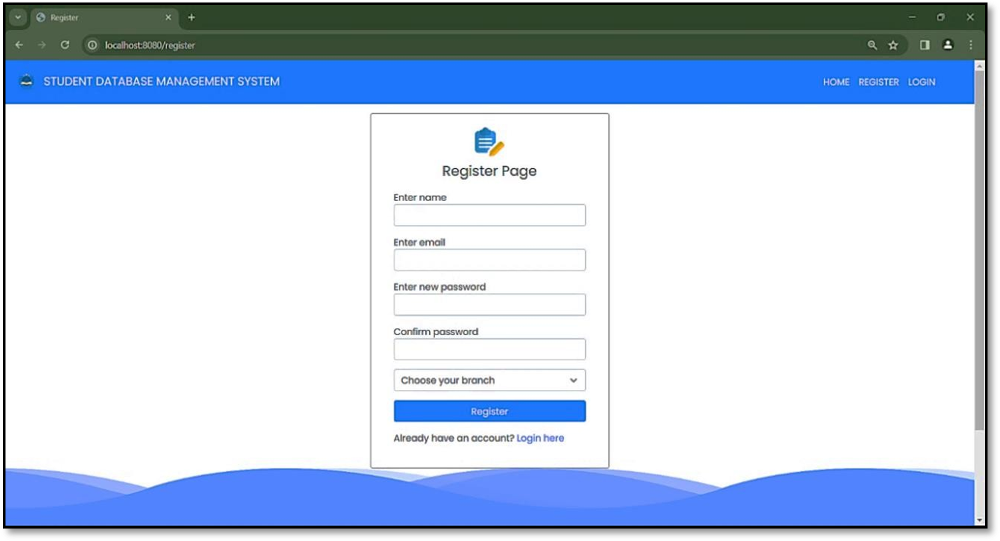

  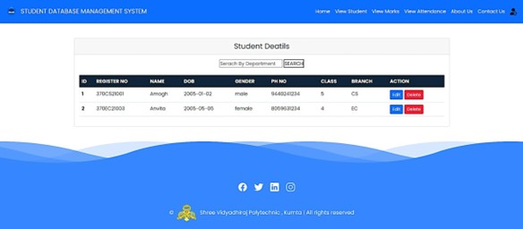
  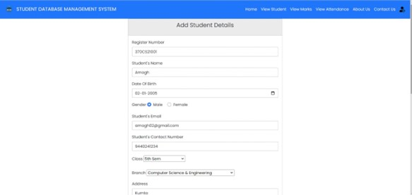

  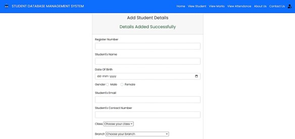
  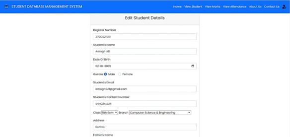

  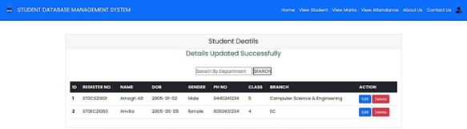
  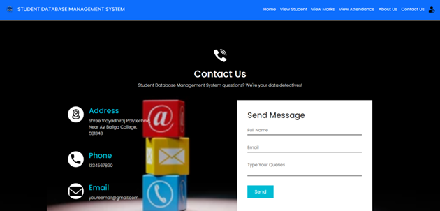

  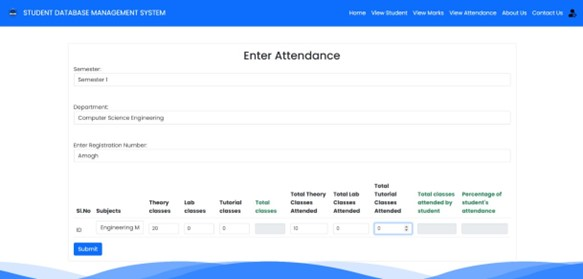
  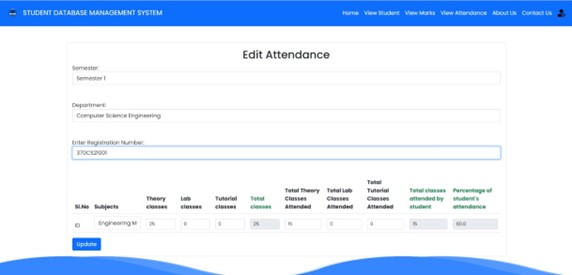

  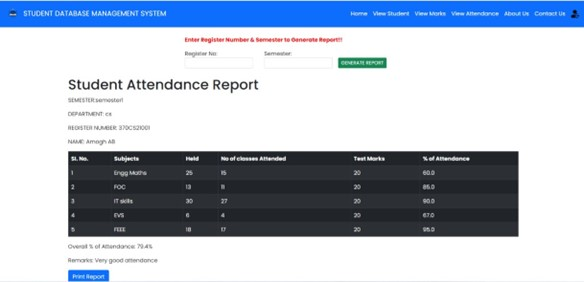

